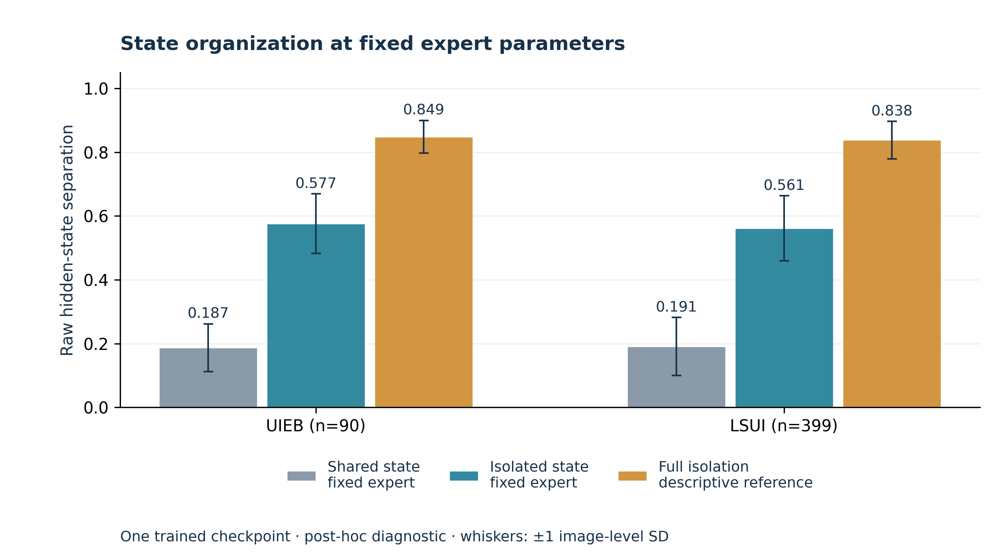

# IsoMamba

**State-Isolated Vision Mamba via Update-Tendency Routing for Underwater Image Enhancement**

Yan Luo, Laibin Chang, Zefan Feng, Yi'ang Chen, Kui Jiang, Zhengguo Li


**arXiv:** The manuscript has been submitted and is awaiting moderation. The paper link and identifier will be added after announcement.

[中文说明](README_zh-CN.md) · [Code audit](docs/CODE_AUDIT.md) · [Figure captions](docs/FIGURES.md)

IsoMamba groups visual tokens using a model-derived update representation and processes each group with a separate recurrent expert. Encoder terminal states coordinate decoder experts through FiLM modulation. The implementation uses a U-shaped network with additive feature skips and an image residual.


Research code for IsoMamba. The arXiv paper announcement, public checkpoint downloads, license choice, and remaining implementation notes are tracked below. Repository: [kkoucy/IsoMamba](https://github.com/kkoucy/IsoMamba).

## Structure

```text
basicsr/
  models/archs/clusterM_arch.py    # Original checkpoint-compatible network
  models/archs/isomamba_arch.py    # Public IsoMamba alias
  models/image_restoration_model.py
  models/losses/                  # Channel-adaptive L1/SSIM and edge losses
  data/                          # Datasets, augmentation, sampling
  metrics/                       # Validation metrics
  utils/                         # Training infrastructure
options/train_IsoMamba.yml        # Portable configuration
train.py                         # Training entry point
test.py                          # Legacy paired evaluation (see caveats)
tools/infer.py                   # Inference without ground-truth images
tools/build_paper_figures.py      # Reproducible vector/raster figures
tools/prepare_release.py          # Non-destructive allowlist export
analysis/                        # Research diagnostics and their unit tests
assets/figures/                   # PNG, SVG and PDF figures
assets/data/                     # Portable aggregate diagnostic data
docs/                            # Audit, figure captions, release notes
```

## Environment

The inspected local environment uses Linux, Python 3.10, PyTorch 2.1.2 + CUDA 11.8, torchvision 0.16.2, mamba-ssm 1.1.1, and causal-conv1d 1.1.1. Model imports, strict checkpoint loading and a CUDA forward under THOP were checked in this environment; a fresh installation and checkpoint-based image evaluation still need validation. The fused selective scan requires CUDA.

```bash
conda create -n isomamba python=3.10 -y
conda activate isomamba
pip install torch==2.1.2 torchvision==0.16.2 --index-url https://download.pytorch.org/whl/cu118
pip install -r requirements.txt
pip install causal-conv1d==1.1.1 mamba-ssm==1.1.1 --no-build-isolation
```

CUDA extension wheels must match Python, PyTorch, CUDA and the C++ ABI; building from source requires a compatible CUDA toolkit and compiler. The local `mamba/` tree identifies itself as 2.2.5 and is not the installed 1.1.1 dependency; it is excluded from the release export.

## Data and training

Obtain the datasets from their original providers and arrange paired inputs/targets with matching filenames. No datasets are redistributed.

```text
datasets/UIEB_LSUI/train/{Input,GT}/
datasets/UIEB/test/{Input,GT}/
```

Edit the paths in `options/train_IsoMamba.yml`, then run from the repository root:

```bash
CUDA_VISIBLE_DEVICES=0 python train.py -opt options/train_IsoMamba.yml
```

The supplied recipe uses 256×256 crops, batch size 2, 300,000 iterations, AdamW at 3e-4, and L1/SSIM/edge weights 8/1/4. It preserves the existing recipe rather than resolving differences with the manuscript. The training entry automatically resumes from the highest numbered state in `experiments/<name>/training_states/`; use a new experiment name for a fresh run. `options/UIE.yml` is the original machine-specific configuration and is excluded from the export.

## Inference

Public checkpoint downloads are pending. Place a compatible checkpoint at `checkpoints/isomamba.pth`:

```bash
CUDA_VISIBLE_DEVICES=0 python tools/infer.py \
  --config options/train_IsoMamba.yml \
  --weights checkpoints/isomamba.pth \
  --input-dir datasets/example/Input --output-dir results/example
```

The command preserves image resolution, pads to a multiple of eight, crops the output back, and saves RGB PNGs. It does not resize to the paper's 256×256 benchmark protocol or calculate benchmark scores. Supported checkpoint layouts are `params`, `params_ema`, or a raw state dict; `--param-key` selects the desired layout explicitly. Routing uses randomized center initialization; `--seed` makes initialization repeatable within the same environment, but bitwise reproducibility across CUDA environments is not guaranteed.

`test.py` is retained for historical paired evaluations. It requires targets, only scans lowercase PNG/JPG, uses SSIM `data_range=1.1`, and must not be treated as the final benchmark protocol without review. Training validation uses a separate metric implementation.

## Paper figures and diagnostics



Figures are supplied as editable SVG, vector PDF, and 300 dpi PNG. Rebuild without a GPU:

```bash
python tools/build_paper_figures.py
python tools/count_parameters.py
python -m unittest analysis.test_state_contention analysis.test_global_state_detach
python analysis/analyze_state_contention.py --self-test
python analysis/analyze_hidden_state_quality.py --self-test
python analysis/analyze_raw_hidden_state_separation.py --self-test
```

The diagnostic plot uses existing UIEB (90) and LSUI (399) aggregate results from a single trained checkpoint. Error bars are image-level standard deviations. The fixed-expert comparison changes recurrence organization while holding tokenwise operands fixed; full isolation also changes experts and is shown only as a descriptive reference. This is a post-hoc diagnostic, not a comparison with an independently trained shared-state baseline. See [captions and provenance](docs/FIGURES.md).

The diagnostic scripts retain historical dataset defaults. Override them explicitly when running elsewhere. The quality and raw-state separation scripts accept paired `--uieb-input-dir`/`--uieb-gt-dir` and `--lsui-input-dir`/`--lsui-gt-dir` arguments, and require exactly one visible CUDA GPU of your choice:

```bash
CUDA_VISIBLE_DEVICES=0 python analysis/analyze_raw_hidden_state_separation.py \
  --checkpoint checkpoints/isomamba.pth --dataset uieb \
  --uieb-input-dir datasets/UIEB/test/Input256 \
  --uieb-gt-dir datasets/UIEB/test/GT256
```

The state-contention script accepts `--input-dir` and `--gt-dir`. All analyses default to the portable network configuration and accept `--config` explicitly.

The original THOP procedure was reproduced on a random **1×3×256×256** CUDA input, returning **15.23 M parameters** and **51.65 G operations** under that profiling convention. Counting every unique registered parameter, including custom state-space tensors and all experts, gives 24.651613 M. These are different counting conventions; see [counting details and reproduction code](docs/PARAMETER_COUNT.md). Encoder context is explicitly detached before FiLM, while FiLM parameters and decoder features remain trainable.

## Preparing a source release

```bash
python tools/prepare_release.py --output /tmp/IsoMamba-release
```

The exporter copies an explicit source allowlist into a new directory and writes SHA-256 hashes. It never deletes or alters source files and refuses an existing destination. Training artifacts, local data, binary wheels, the anonymous manuscript, vendored Mamba, and the original local configuration are excluded. This is a preparation command; it does not initialize Git or publish to GitHub. Review [release tasks](docs/RELEASE.md) before publication.

## Citation and attribution

The supplied author order is recorded above. A formal BibTeX entry will be added when the publication year, venue and public paper identifier are confirmed.

The project includes code derived from BasicSR and uses Mamba, PyTorch, timm and other dependencies. Third-party source provenance and licenses require review before release; see [THIRD_PARTY_NOTICES.md](THIRD_PARTY_NOTICES.md). A project license has not yet been selected.
