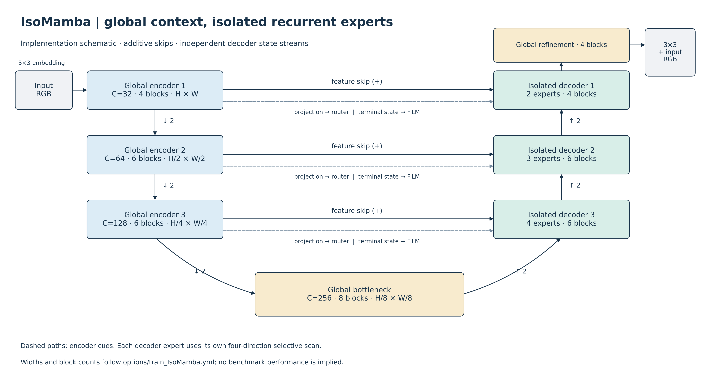

# IsoMamba

论文标题：**State-Isolated Vision Mamba via Update-Tendency Routing for Underwater Image Enhancement**

作者：Yan Luo, Laibin Chang, Zefan Feng, Yi'ang Chen, Kui Jiang, Zhengguo Li

仓库：<https://github.com/kkoucy/IsoMamba>。


**arXiv：论文已提交，目前仍在审核，公开后补充编号和文章链接。** 权重下载、项目许可证及实现说明见英文 README。

模型通过来自编码器投影的更新表征进行聚类与路由，将不同组的 token 分配到独立的 Mamba 专家，并通过编码器终态生成 FiLM 调制。主体为四层 U 形网络，包含加法跳连、全局建模的细化模块和图像残差。



安装环境（Linux、NVIDIA GPU；以下使用 Python 3.10、PyTorch 2.1.2 和 CUDA 11.8）：

```bash
git clone https://github.com/kkoucy/IsoMamba.git
cd IsoMamba
conda create -n isomamba python=3.10 -y
conda activate isomamba
pip install torch==2.1.2 torchvision==0.16.2 --index-url https://download.pytorch.org/whl/cu118
pip install -r requirements.txt
pip install packaging ninja wheel setuptools
pip install causal-conv1d==1.1.1 --no-build-isolation
pip install mamba-ssm==1.1.1 --no-build-isolation
```

Mamba 直接通过以上命令安装，无需本地源码或 wheel。如果没有匹配的预编译 wheel，需要安装包含 `nvcc` 的 CUDA 11.8 Toolkit，并设置 `CUDA_HOME` 后重试。安装检查命令见英文 README。

完整安装、训练、推理命令见 [英文 README](README.md)。新增配置 `options/train_IsoMamba.yml` 使用相对路径并取消本机断点。公开名称 `IsoMamba` 是原 `ClusterMamba` 类的别名，不改变参数名称或计算过程。

```bash
# 在依照英文 README 安装环境、准备数据后执行
CUDA_VISIBLE_DEVICES=0 python train.py -opt options/train_IsoMamba.yml
CUDA_VISIBLE_DEVICES=0 python tools/infer.py \
  --weights checkpoints/isomamba.pth \
  --input-dir datasets/example/Input --output-dir results/example
```

训练程序会自动恢复同名实验目录下最新的 `.state`，重新训练时应更换实验名称。推理保留原始分辨率，不自动执行论文的 256×256 评测预处理。历史 `test.py` 的 SSIM 设置为 `data_range=1.1`，与训练验证指标不同，尚不能作为统一评测协议。

方法图直接截取自论文第 3 页 Figure 3。发布包仅保留模型、训练、推理和参数统计所需代码，不包含重绘脚本和额外诊断图。Mamba 依赖按英文 README 安装 `mamba-ssm==1.1.1`。

输入尺寸为 **1×3×256×256** 时，THOP 统计结果为 **Params: 15.23M、FLOPs: 51.65G**。
